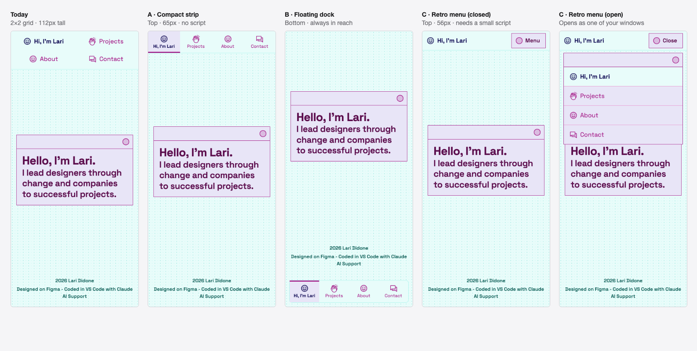
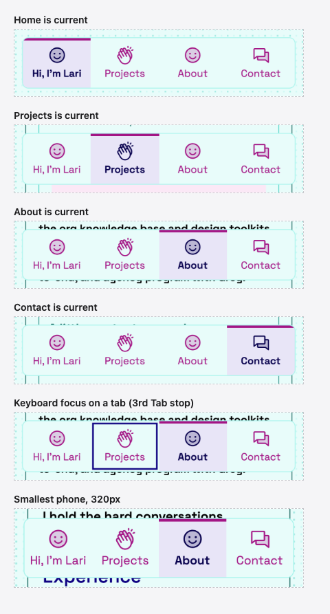
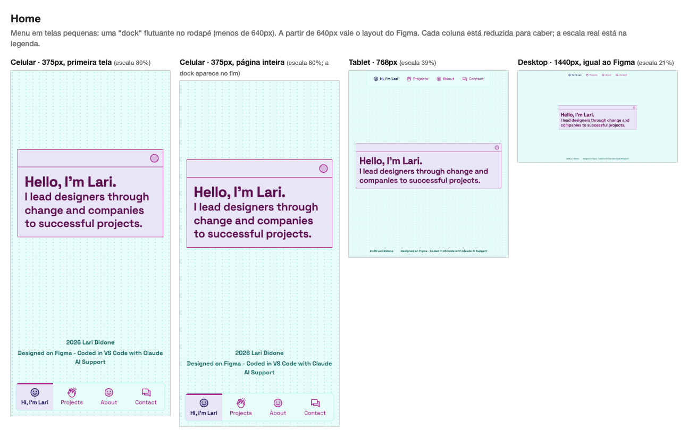
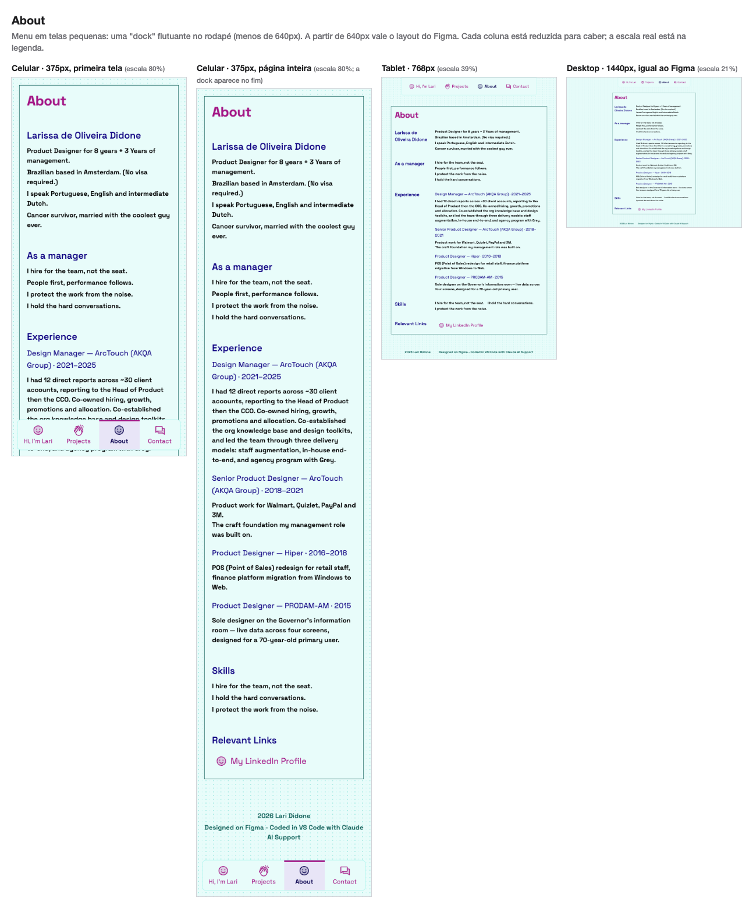
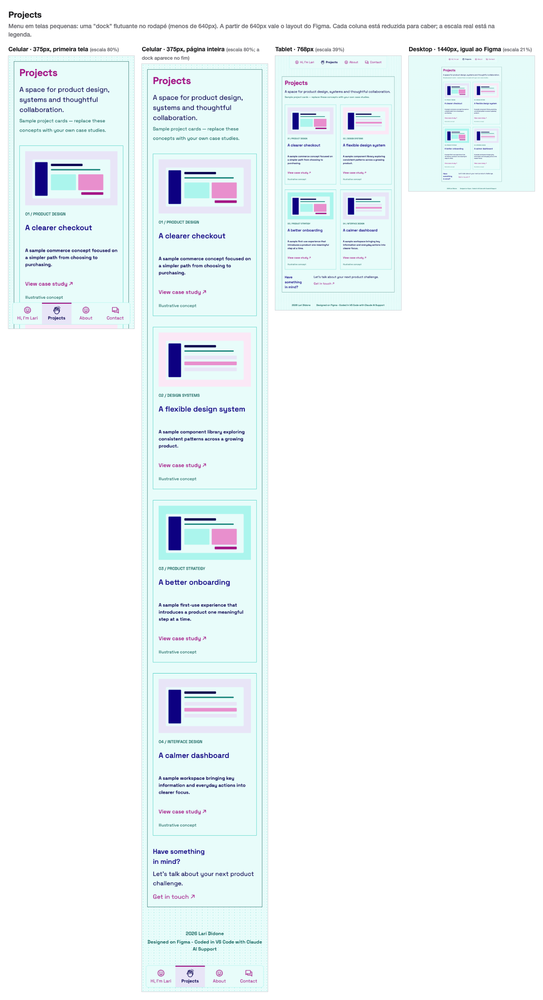
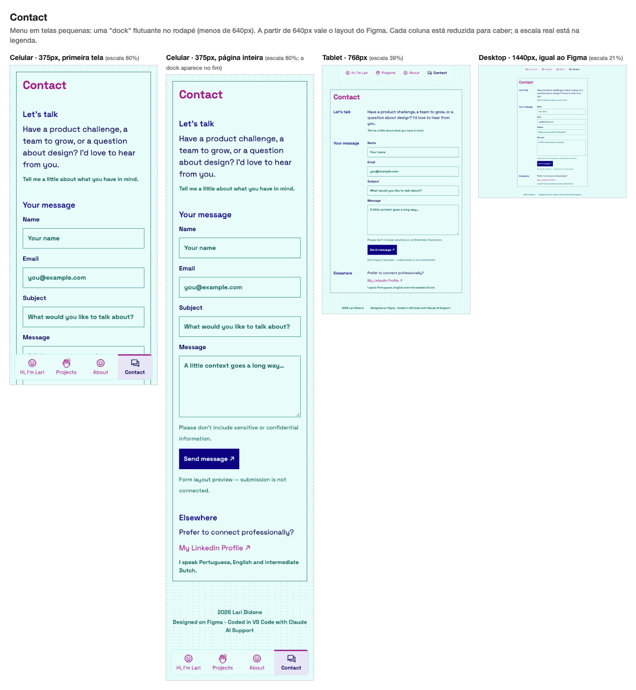

# Redimensionamento: como o site se adapta a telas menores

O Figma só tem frames de desktop (1440px). Este documento descreve como o site se adapta a telas menores. **Já está implementado no código** para você poder ver e testar, mas nada disso existe no Figma até você aprovar (ou ajustar). O menu do celular já foi decidido por você; o resto aguarda sua aprovação.

## Decisão: o menu do celular é uma "dock" flutuante

A primeira proposta era uma grade 2×2 no topo. Você não gostou (ocupava 112px da tela e parecia uma grade comum), então mostrei três direções e **você escolheu a B, a dock**.

**Como ela funciona:** uma barra flutuante, encostada no rodapé da tela com 12px de margem e os mesmos cantos arredondados da barra de desktop, com as 4 abas iguais (ícone sobre o rótulo). A página atual tem fundo lavanda, uma barra rosa no topo, texto pesado e ícone preenchido, então não depende só de cor. Fica ao alcance do polegar e mostra os 4 destinos o tempo todo.

**Uma barra fixa embaixo traz riscos de acessibilidade. Cada um foi tratado e testado:**

| Risco                                               | O que foi feito                                                                                                                                                                                                                    | Como foi conferido                                                                                               |
| --------------------------------------------------- | ---------------------------------------------------------------------------------------------------------------------------------------------------------------------------------------------------------------------------------- | ---------------------------------------------------------------------------------------------------------------- |
| Cobrir o fim da página                              | Espaço extra embaixo do conteúdo (`padding` de 6rem)                                                                                                                                                                               | Com a página rolada até o fim, o rodapé termina acima da dock em 320, 375 e 390px de largura                     |
| O foco do teclado parar atrás da dock (WCAG 2.4.11) | `scroll-padding-bottom`: o navegador rola o elemento focado para uma área livre                                                                                                                                                    | 45 paradas do Tab (15 em cada uma de 3 páginas): nenhuma ficou escondida                                         |
| Janela baixa ou muito zoom (WCAG 1.4.10)            | A dock só existe com 320px de largura ou mais **e** 480px de altura ou mais (medido em `em`). Abaixo disso vira uma **faixa no topo**, que rola com a página e nunca cobre nada                                                    | Testado em 375×400, 310×800 e 800×800                                                                            |
| Texto aumentado                                     | Com a fonte do navegador maior, os limites em `em` sobem e a faixa volta sozinha. Para controles de texto que o CSS não enxerga (como o do Safari no iPhone), `js/text-size.js` marca a página e a faixa volta, com as abas em 2×2 | Simulado a 150% e 200%. Sem essa proteção, a 200% a dock chegava a cobrir 35% da tela e escondia o fim da página |
| Ordem do Tab × ordem visual                         | A navegação continua **primeiro no HTML**, mesmo aparecendo embaixo. Quem usa teclado ou leitor de tela a encontra logo no começo, e existe o link "Pular para o conteúdo". É um compromisso conhecido dessa escolha               | Documentado aqui                                                                                                 |
| Modo de alto contraste (Windows)                    | A página atual ganha sublinhado, porque o fundo e a barra colorida somem nesse modo                                                                                                                                                | Regra `forced-colors` em `css/styles.css`                                                                        |
| Alvos de toque pequenos                             | Cada aba tem cerca de 85×64px                                                                                                                                                                                                      | `npm run check` (axe) sem problemas                                                                              |

## Princípios

1. **Um único ponto de quebra: 640px.** A partir dele vale exatamente o layout do Figma; abaixo dele o conteúdo empilha. Os cartões ainda "quebram" sozinhos quando faltar espaço. A dock tem condições próprias, descritas acima.
2. **Medido em `em`, não em `px`.** `40em` equivale a 640px, mas se a pessoa aumentar a fonte do navegador o ponto de quebra sobe junto, e ela ganha o layout empilhado mais cedo. Isso ajuda quem precisa de texto grande.
3. **Nenhuma largura fixa.** Painel, janela, campos e cartões usam "no máximo X, senão a largura disponível".
4. **O texto grande encolhe com a tela** (título e subtítulo da Home, H1 das páginas) e para no tamanho do Figma a partir de ~720px. O texto pequeno (14px) não muda.
5. **Alvos de toque de 44px ou mais** nas abas, e 52px nos campos e no botão.

## Elemento por elemento

| Elemento                              | 640px ou mais (= Figma)                                         | Menos de 640px                                                                                                                                 | Por quê                                                                   |
| ------------------------------------- | --------------------------------------------------------------- | ---------------------------------------------------------------------------------------------------------------------------------------------- | ------------------------------------------------------------------------- |
| **Navegação**                         | 1 linha, centralizada, com borda e cantos de baixo arredondados | **Dock flutuante** no rodapé da tela (4 abas iguais, ícone sobre o rótulo). Em janela baixa, estreita ou com texto muito grande: faixa no topo | Ao alcance do polegar e sempre visível; as proteções estão na seção acima |
| **Janela da Home**                    | 700px, centralizada                                             | Largura total com 16px de margem, centralizada na altura da tela                                                                               | Mantém o "pop-up" retrô sem cortar texto                                  |
| **Título da Home**                    | 48px                                                            | 32px (320px de largura) → 34px (375px) → 48px (720px ou mais)                                                                                  | Escala suave, sem saltos                                                  |
| **Subtítulo da Home**                 | 36px                                                            | 24px (320px) → 26px (375px) → 36px (720px ou mais)                                                                                             | Idem                                                                      |
| **H1 das páginas**                    | 36px                                                            | 28px (320px) → 29px (375px) → 36px (770px ou mais)                                                                                             | Idem                                                                      |
| **Painel** (About, Projects, Contact) | 686px, centralizado                                             | Largura total com 16px de margem e o mesmo padding interno                                                                                     | Aproveita a largura                                                       |
| **Linhas rótulo + conteúdo**          | 2 colunas: rótulo de 145px + conteúdo                           | **Empilha**: rótulo em cima, conteúdo embaixo                                                                                                  | Em 375px, 145px de rótulo deixaria só ~130px para o conteúdo              |
| **Cartões de projeto**                | 2 colunas de 314px                                              | **1 coluna** de largura total; a partir de ~620px de largura, 2 colunas                                                                        | A ilustração mantém a proporção 280:164 em qualquer largura               |
| **Formulário**                        | Campos de 475px à direita do rótulo                             | Campos de largura total, empilhados sob o rótulo                                                                                               | Campo largo é mais fácil de tocar e de ler                                |
| **Rodapé**                            | 2 textos nas pontas, numa faixa de 566px                        | Empilhado e centralizado; o texto longo pode quebrar em 2 linhas                                                                               | Não cabe em uma linha em 375px                                            |
| **Fundo pontilhado**                  | tile de 16×8px                                                  | igual                                                                                                                                          | Não depende da largura                                                    |

## Veja como ficou (celular · tablet · desktop)

Cada folha mostra a primeira tela do celular, a página inteira (com a dock no fim), o tablet e o desktop.

**Para ver ao vivo:** abra o site no Live Server, depois no Chrome use `⌥⌘I` (DevTools) e `⇧⌘M` (modo celular) e escolha, por exemplo, "iPhone SE" ou "iPhone 14".

## O que já foi testado

Em Chrome, nas 4 páginas:

- **Larguras de 320, 375, 640, 768, 1024 e 1440px:** nenhuma rolagem horizontal. (320px é o que a WCAG usa para o zoom de 400%.)
- **A dock em 320×568, 375×812 e 390×844:** fica fixa, a 12px da borda de baixo, com 66px de altura, e o rodapé nunca fica escondido atrás dela.
- **Quando a dock não deve aparecer:** em janela baixa (375×400), estreita (310px) e larga (800px), a navegação volta para o topo.
- **Texto grande:** a 150% e 200% o menu vira a faixa 2×2 no topo, sem cobrir conteúdo. A 200% numa janela de 1280px, nada estoura.
- **Espaçamento de texto aumentado** (altura de linha 1,5, espaço entre letras e palavras maiores, regra WCAG 1.4.12): nada é cortado.
- **Teclado:** ordem do Tab lógica, anel de foco visível em todos os elementos (dentro da dock, o anel fica por dentro da aba), link "Pular para o conteúdo" funcionando, nenhum foco escondido pela dock.
- **Desktop:** medido de novo depois da dock. Continua idêntico ao Figma (janela 700×217, cartões, campos e painéis).
- **`npm run check`** (axe em 375px e 1280px): nenhum problema.

Ainda falta, e só você ou um aparelho real faz: **testar num celular de verdade** (principalmente a dock com a barra do Safari embaixo) e com **VoiceOver**.

## Alternativas consideradas

| Alternativa                                                | Por que não                                                                                                              |
| ---------------------------------------------------------- | ------------------------------------------------------------------------------------------------------------------------ |
| Grade **2×2** no topo (primeira proposta)                  | Ocupava 112px da tela e parecia uma grade comum. Você não gostou. Hoje é só o formato de reserva para texto muito grande |
| **Faixa compacta** no topo (opção A)                       | Boa, simples e sem JavaScript, mas só um pouco melhor que o 2×2. Virou a versão de reserva da dock                       |
| **Menu retrô** (opção C): botão "Menu" que abre uma janela | Mais "a sua cara", mas esconde os 4 destinos atrás de um toque e precisa de JavaScript                                   |
| Menu "hambúrguer"                                          | Precisa de JavaScript e esconde os 4 destinos atrás de um toque extra                                                    |
| Abas numa linha com rolagem horizontal                     | Esconde itens e a rolagem horizontal dificulta o uso (e desrespeita o reflow da WCAG 1.4.10)                             |
| **Dock flutuante** (opção B)                               | **Escolhida por você.** Sempre visível e ao alcance do polegar; os riscos estão tratados na seção acima                  |

## Para você decidir

- [x] Menu do celular: **dock flutuante** (decidido em 08/10)
- [ ] Título e subtítulo da Home **fluidos** (32 → 48px)
- [ ] Cartões em **1 coluna** no celular (2 a partir de ~620px)
- [ ] Rótulos **empilhados** acima do conteúdo no celular
- [ ] Rodapé **empilhado** e centralizado
- [ ] Margens laterais de **16px**

**Depois de aprovar, como levar isso para o Figma:**

1. Você desenha os frames de 375px (e 768px, se quiser) usando esta proposta como referência; ou
2. eu desenho esses frames no seu arquivo do Figma a partir desta proposta (isso escreve no seu arquivo, então só faço com o seu "pode fazer"); ou
3. o comportamento fica só no código e este documento é a referência. É o mais rápido, mas o Figma fica sem as versões pequenas e o risco de o design e o código se afastarem aumenta.
